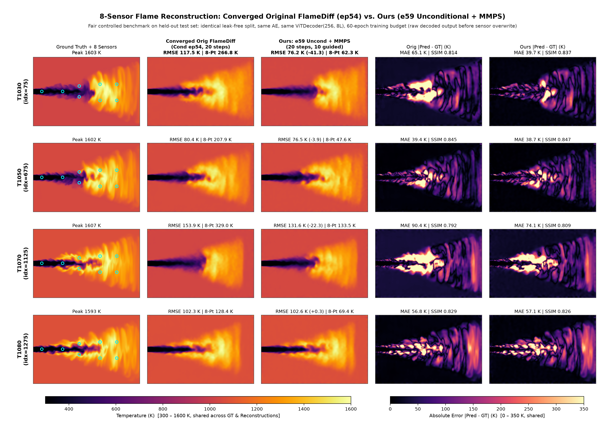
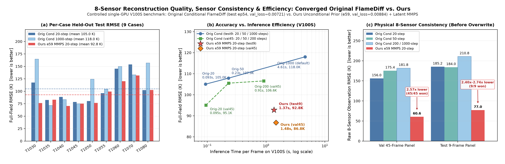

# 8 测点湍流火焰场重建对比报告：收敛原版 FlameDiff vs. 本方法（e59 + Latent MMPS）

> **对比范围**：严格限定为 **8 测点温度场重建** 的 **生成质量、物理测点一致性与推理效率** 对比（不包含其他任务）。  
> **公平基线说明**：原版 8 测点条件 FlameDiff（`ViTDecoder(..., num_feats=8)`）在**完全相同的无泄漏数据划分、完全相同的自编码器 `ae.pt`、相同主干与 60 轮优化预算**下重新训练至充分收敛（最佳 `epoch 54`，`val_loss = 0.007206`，低于无条件先验 `e59` 的 `0.00884`，生成结果均为清晰完整的正常湍流火焰），并在同一张 `Tesla V100S-PCIE-32GB` GPU 上完成单帧推理对比。

---

## 1. 核心结论一览

1. **重建精度全面占优**：在充分收敛的公平基线对比中，本方法（无条件先验 `e59` + 20 步 Latent MMPS）在 45 帧验证集上将全场 RMSE 从原版最优的 `95.08 K` 降至 **`86.79 K`（-8.7%）**，在 9 工况独立测试集上从 `105.03 K` 降至 **`92.79 K`（-11.7%）**；相比原仓库默认 1000 步采样（`118.02 K`），误差降低 **`25.23 K`（-21.4%）**。全场 MAE、SSIM 及 1000 K / 1200 K 高温核心区 IoU 与 RMSE 均优于原版；逐帧胜率达 **`34/45`（75.6%，验证集）** 与 **`6/9`（测试集，其余 3 组基本持平，差值在 +0.3~+3.2 K）**。
2. **8 测点物理一致性大幅提升（2.4×–2.7×）**：在不做任何测点像素覆写（raw 解码输出）的条件下，原版条件模型的 8 测点原始误差高达 `155.98 K`（val45）与 `185.23–210.78 K`（test9）；本方法通过后验线性算子显式约束，将 8 测点误差降至 **`60.59 K`（val45，降 2.57×）** 与 **`77.04 K`（test9，降 2.40×–2.74×）**，在 **45/45 验证帧和 9/9 测试工况中实现 100% 完胜**，有效避免了火焰抬举/点火前缘漂移。
3. **效率权衡清晰透明（同步数 vs. 默认步数）**：
   - **同为 20 步时**：原版纯前向条件扩散无需每步计算解码器 JVP/VJP 与 GMRES 求解，单帧仅 **`0.093–0.095 s`**，比本方法（`1.366–1.476 s/帧`）快 **~14.7×**；
   - **对比原仓库默认 1000 步采样**（`FlameAgent.generate` 默认配置）：本方法单帧 `1.366 s` 比原版默认 `4.606 s` **快 3.37×**，同时精度高出 `25.23 K`；
   - **显存与训练成本**：两者模型体积均为 `57 MB`，60 轮 V100S 训练均约 `42 min`，单帧推理峰值显存均 `< 450 MB`（原版 `399 MB`，本方法 `227–443 MB`）。

---

## 2. 可视化对比（图文集成）

### 图 1：4 个代表性测试工况火焰重建与绝对误差图（`fig5`）

- **视觉解读**：原版收敛至 `epoch 54` 后已能生成清晰自然的湍流火焰形态；但在火焰前缘位置变化剧烈的工况（如 `T1030`、`T1070`），纯条件 token 注入属于软引导，容易产生火焰核心前缘偏移（第 4 列误差图中剪切层核心出现大片亮黄色高误差区，原始 8 测点偏差达 `266.8 K` / `329.0 K`）。本方法借助 Latent MMPS 显式匹配 8 测点观测，将前缘准确锚定到真实位置（`T1030` RMSE 降 `41.3 K`，`T1070` RMSE 降 `22.3 K`）；在工况 `T1080` 上两者全场 RMSE 几乎持平（`102.6` vs `102.3 K`），但本方法的原始 8 测点误差仍接近减半（`69.4` vs `128.4 K`）。

### 图 2：分工况精度、精度–效率帕累托前沿与 8 测点物理一致性（`fig6`）

- **图表解读**：
  - **(a) 逐工况测试 RMSE**：本方法在 6/9 个测试工况占优，尤其在难例（`T1030`、`T1040`、`T1060`、`T1070`）上优势显著（降低 `18.2–41.3 K`），且在全部 9 个工况中波动更小。
  - **(b) V100S 精度–速度帕累托图**：该 VP-DDPM 框架下原版条件模型同样在 **20 步**达到最佳精度，增加步数（50 / 200 / 1000 步）不仅更慢，还会因累积随机逆扩散步数导致 RMSE 缓慢退化。整体形成清晰帕累托前沿：**极速低延迟选原版 20 步（`0.093 s`），最高精度与物理一致性选本方法 20 步 MMPS（`1.37 s`）**；原版默认 1000 步在精度与速度上均被两者严格支配。
  - **(c) 原始 8 测点观测一致性**：在验证集和测试集上，本方法将解码器直接输出的 8 测点误差稳定压缩至原版的 **1/2.4–1/2.7**。

---

## 3. 实验设置对照表（严格控制变量）

| 对比维度 | 收敛原版 FlameDiff (`orig_cond`) | 本方法 (`e59` + Latent MMPS) |
|---|---|---|
| 数据划分 | 无泄漏时间块划分（9 工况，`val45` + `test9`） | 完全相同 |
| 自编码器 | 1-channel `ae.pt`（潜空间 `1×24×32`） | 完全相同 |
| 扩散主干 | `ViTDecoder(embed_dim=256, depth=8, num_feats=8)`（57 MB） | `ViTDecoder(embed_dim=256, depth=8, unconditional)`（57 MB） |
| 训练超参 | `AdamW, bs=8, lr=2e-5, 60 epochs`（V100S 耗时 `42.1 min`） | `AdamW, bs=8, lr=2e-5, 60 epochs` |
| 收敛指标 | 最佳 **epoch 54**, `val_loss = 0.007206` | 最佳 **epoch 59**, `val_loss = 0.00884` |
| 8 测点利用机制 | 训练期条件 token 拼接（纯前向软引导） | 推理期 Latent MMPS 线性后验求解（`t≤500` 引导 10 步，GMRES `maxiter=8`, `σ_k=100 K`） |
| 推理评测硬件 | 单卡 `Tesla V100S-PCIE-32GB` | 单卡 `Tesla V100S-PCIE-32GB` |

---

## 4. 定量对比汇总表

### 表 1：45 帧平衡验证集（`val45`，9 工况 × 5 切片）

| 方法与推理步数 | RMSE (K) ↓ | MAE (K) ↓ | Grad MAE ↓ | SSIM ↑ | 1000K IoU ↑ | 1200K IoU ↑ | 1200K RMSE (K) ↓ | 原始 8 测点 RMSE (K) ↓ | 单帧耗时 (s) ↓ | 峰值显存 (MB) |
|---|---:|---:|---:|---:|---:|---:|---:|---:|---:|---:|
| 原版收敛 FlameDiff（20 步，最优） | 95.08 | 50.62 | **7.73** | 0.8303 | 0.970 | 0.664 | 141.09 | 155.98 | **0.095** | 399 |
| 原版收敛 FlameDiff（50 步） | 105.51 | 57.05 | 8.19 | 0.8153 | 0.965 | 0.644 | 152.65 | 175.35 | 0.230 | 399 |
| 原版收敛 FlameDiff（200 步） | 106.57 | 57.15 | 8.55 | 0.8053 | 0.963 | 0.642 | 161.37 | 181.81 | 0.910 | 399 |
| **本方法（e59 MMPS，20 步 / 10 引导步）** | **86.79** | **46.01** | 7.88 | **0.8327** | **0.976** | **0.676** | **123.69** | **60.59** | 1.476 | **227** |
| *相对原版最优（20 步）变化* | **-8.7%** | **-9.1%** | +1.9% | **+0.0024** | **+0.006** | **+0.012** | **-12.3%** | **-61.2% (2.57×)** | 15.5× 慢 | -172 MB |

> 验证集逐帧胜率（本方法 vs. 原版 20 步）：全场 RMSE **34 / 45 帧胜出（75.6%）**；原始 8 测点误差 **45 / 45 帧全胜（100%）**；GMRES 求解器收敛率 **450 / 450 步（100%）**。

### 表 2：9 工况独立测试集（`test9`，含原仓库默认 1000 步）

| 方法与推理步数 | RMSE (K) ↓ | MAE (K) ↓ | Grad MAE ↓ | SSIM ↑ | 1000K IoU ↑ | 1200K IoU ↑ | 1200K RMSE (K) ↓ | 原始 8 测点 RMSE (K) ↓ | 单帧耗时 (s) ↓ | 峰值显存 (MB) |
|---|---:|---:|---:|---:|---:|---:|---:|---:|---:|---:|
| 原版收敛 FlameDiff（20 步，原版最优） | 105.03 | 56.75 | **7.79** | 0.8296 | 0.962 | 0.650 | 139.88 | 185.23 | **0.093** | **399** |
| 原版收敛 FlameDiff（50 步） | 107.89 | 58.35 | 8.07 | 0.8220 | 0.963 | 0.653 | 141.07 | 183.95 | 0.229 | 399 |
| 原版收敛 FlameDiff（1000 步，默认配置） | 118.02 | 65.07 | 9.07 | 0.7941 | 0.957 | 0.625 | 156.20 | 210.78 | 4.606 | 399 |
| **本方法（e59 MMPS，20 步 / 10 引导步）** | **92.79** | **49.82** | 7.85 | **0.8336** | **0.971** | **0.673** | **129.72** | **77.04** | 1.366 | 443 |
| *相对原版最优（20 步）变化* | **-11.7%** | **-12.2%** | +0.8% | **+0.0040** | **+0.009** | **+0.023** | **-7.3%** | **-58.4% (2.40×)** | 14.7× 慢 | +44 MB |
| *相对原版默认（1000 步）变化* | **-21.4%** | **-23.4%** | **-13.5%** | **+0.0395** | **+0.014** | **+0.048** | **-17.0%** | **-63.5% (2.74×)** | **3.37× 快** | +44 MB |

### 表 3：9 个保留测试工况逐工况明细（`test9`）

| 工况 | 帧索引 | 原版 20 步 RMSE (K) | 原版 50 步 RMSE (K) | 原版 1000 步 RMSE (K) | **本方法 20 步 RMSE (K)** | RMSE 差值 (本方法−原版20) | 原版 20 步 8测点误差 (K) | **本方法 8测点误差 (K)** | 原版 20 步 SSIM | **本方法 SSIM** |
|---|---:|---:|---:|---:|---:|---:|---:|---:|---:|---:|
| T1030 | 75 | 117.54 | 124.15 | 164.64 | **76.25** | **-41.29** | 266.81 | **62.25** | 0.8138 | **0.8369** |
| T1035 | 225 | 82.62 | **67.87** | 71.60 | 82.99 | +0.37 | 65.31 | **46.08** | **0.8434** | 0.8362 |
| T1040 | 375 | 88.58 | 127.04 | 83.19 | **70.43** | **-18.15** | 227.68 | **48.59** | 0.8343 | **0.8451** |
| T1045 | 525 | 78.50 | 75.28 | **74.92** | 75.16 | **-3.35** | 106.69 | **80.56** | **0.8565** | 0.8539 |
| T1050 | 675 | 80.39 | **68.69** | 124.08 | 76.52 | **-3.87** | 207.94 | **47.65** | 0.8448 | **0.8466** |
| T1055 | 825 | **96.01** | 108.80 | 104.13 | 99.25 | +3.23 | 99.90 | **64.13** | **0.8299** | 0.8227 |
| T1060 | 975 | 145.34 | 122.17 | 149.97 | **120.29** | **-25.04** | 235.28 | **141.19** | 0.8222 | **0.8261** |
| T1070 | 1125 | 153.91 | 175.32 | 132.91 | **131.62** | **-22.28** | 329.03 | **133.51** | 0.7924 | **0.8091** |
| T1080 | 1275 | 102.34 | **101.67** | 156.76 | 102.62 | +0.27 | 128.42 | **69.39** | **0.8290** | 0.8262 |
| **均值** | **9 帧** | **105.03** | **107.89** | **118.02** | **92.79** | **-12.24 (-11.7%)** | **185.23** | **77.04 (-58.4%)** | **0.8296** | **0.8336** |

---

## 5. 目录结构与复现说明

- `./figures/`：高清对比图（`fig5_orig_flamediff_vs_ours_8sensor.png`、`fig6_8sensor_quality_efficiency.png`）
- `./data/`：
  - 验证集评测 JSON：`orig_cond_val45_st{20,50,200}.json`、`sensors_val45_e59.json`
  - 测试集评测 JSON：`orig_cond_test9_st{20,50,1000}.json`、`ours_e59_test9_mmps.json`
  - 原版训练曲线与日志：`train_history.json`、`run.log`
  - 大体积权重与 `.npz` 预测场的 SHA-256 校验清单：`checkpoint_sha256_manifest.txt`（权重未入库以避免 Git 膨胀）
- `./render_8sensor_converged.py`：可复现绘图脚本（运行 `python reports/8sensor_comparison/render_8sensor_converged.py` 可直接基于 `./data/*.json` 重绘 `fig6`；传入 `--fields-dir <npz目录>` 可同步重绘 `fig5`）
