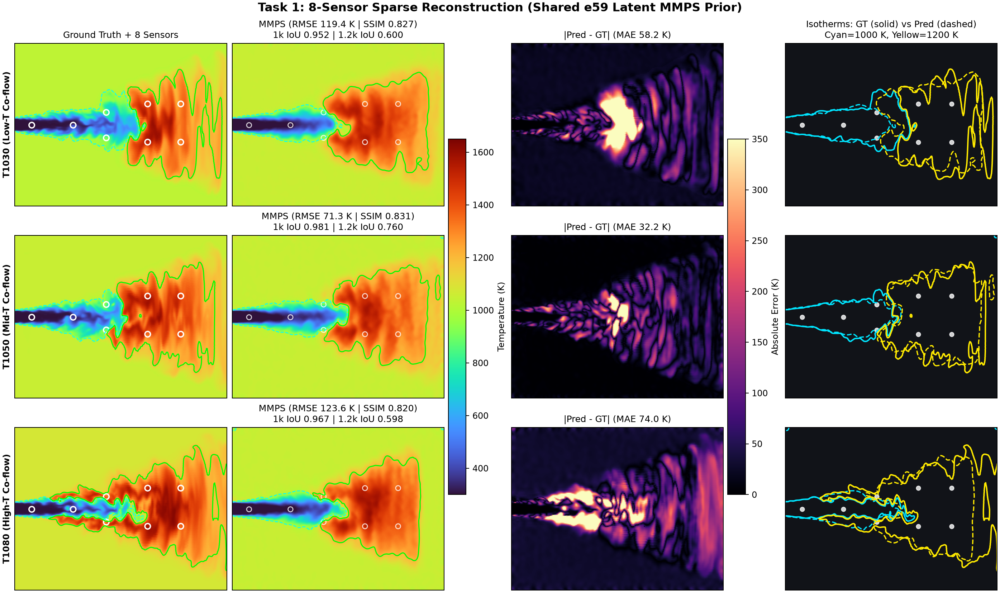
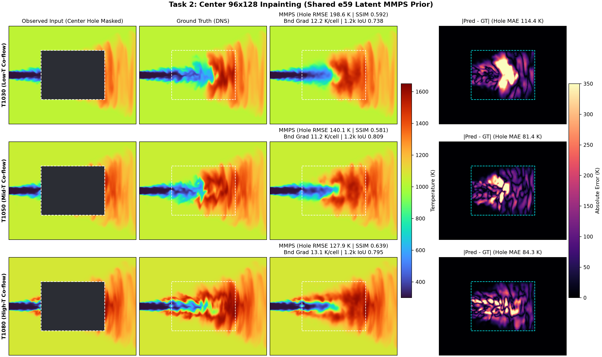
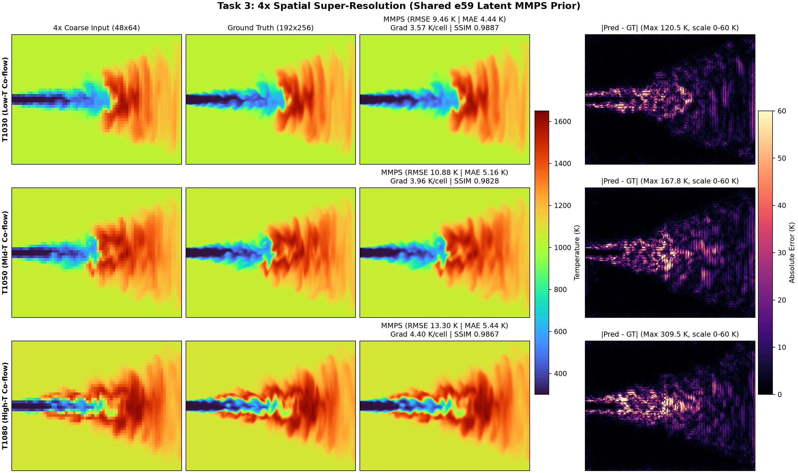
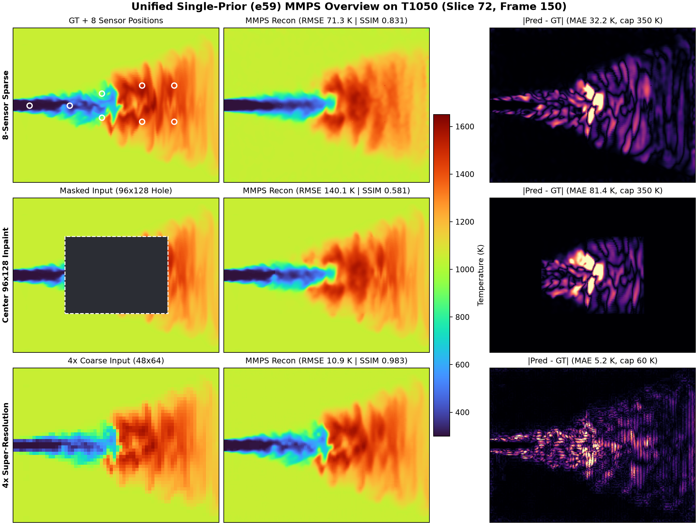

# 统一先验（e59）三工况 Latent MMPS 可视化展示与 45 帧评测

本目录归档同一无条件潜空间先验 `e59` 配合冻结默认参数在三类逆问题上的定性重建效果图，以及 45 帧平衡验证集（`val45`）完整评测报告（[val45_benchmark_report.md](./val45_benchmark_report.md)）。

> 如需查看与**收敛原版 8 测点 FlameDiff（ep54）**的严格单任务对比报告（仅 8 测点质量与效率），请见 [../8sensor_comparison/README.md](../8sensor_comparison/README.md)。

## 1. 8 测点稀疏重建（`sensors`）

## 2. 中心矩形区域修补（`inpaint`）

## 3. 4× 空间超分辨率（`sr`）

## 4. 典型工况（T1050）三任务全景总览

