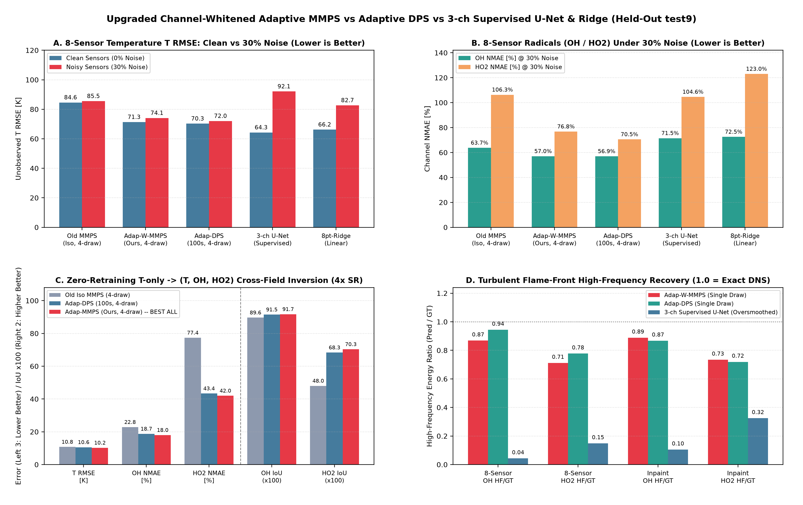
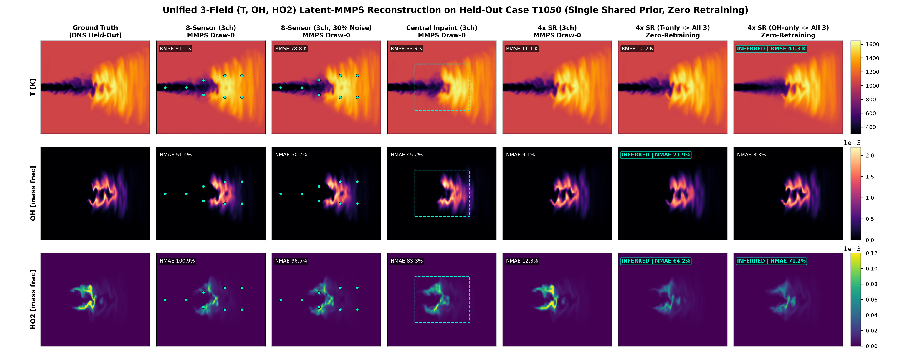
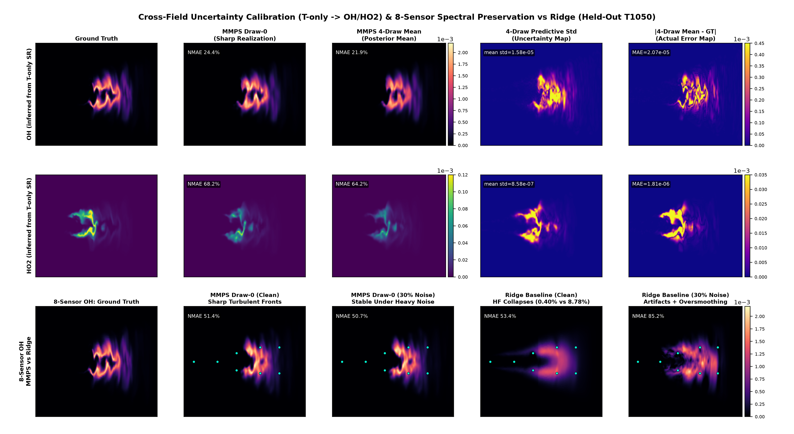
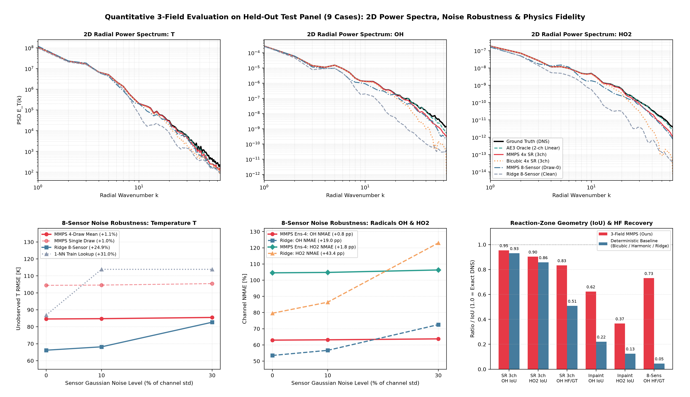

# 湍流火焰场多物理量重建与超分辨率：阶段进度简报

**代码仓库**：`Humorhunter/FlameDiff`（`main` 分支保留完整核心实现与测试；历史消融与诊断脚本归档于 `archive/experiments-20261126`）  
**评测口径**：严格时间隔离留出测试集 `test9`（9 工况中值切片中帧，训练 `[0,130)` / 验证 `[140,160)` / 测试 `[170,200)`）。

---

## 一、代码演进时间线与各版本核心进步

| 版本 | 关键代码改动 | 实现的新功能 | 核心效果进步 |
|---|---|---|---|
| **v0 原版 FlameDiff** | 上游条件扩散（`ViTDecoder, num_feats=8`） | 仅支持单通道 `T` 固定 8 测点重建 | `test9`: `T` RMSE `105.0–118.0 K`，默认 1000 步 `4.61 s/帧`；无法做遮挡修复或超分 |
| **v1 单场统一 Latent-MMPS** | 新增 `spatial_mmps*.py` + 无条件 `ViT` 先验 | **单一先验零重训**支持 8 测点 / 中心遮挡 / 4× 超分 | 8 测点 `test9` 降至 **`92.8 K`（-21.4%）**、提速 **3.4×**（`1.37 s/帧`）；4× SR 达 `10.9 K`（远胜 Bicubic） |
| **v2 三物理场 `(T,OH,HO2)` 统一框架** | 线性编解码 + 潜空间标准化 + 余弦 EMA + 通道选择算子 | 单一先验同时重建 **`(T, OH, HO2)`**，且**零重训支持跨场反演**（`T-only` / `OH-only → 3 场`）+ 4-draw 不确定性/CRPS + 2D 能谱 | 三场 4× SR 全超 Bicubic **23%–24%**；零重训仅靠低分 `OH` 反演 `T` 至 `46 K`；30% 噪声下几乎不退化 |
| **v3 通道白化自适应 MMPS + 自适应 DPS** | 将课题组前作（*Combust. Flame* 282, 2025）自适应归一化改写进各向异性白化 MMPS，并补齐 3 通道监督 U-Net 基线 | 同时支持 `--guidance-mode mmps`（`Adap-W-MMPS`）与 `dps`（`Adap-DPS`），满秩 Krylov 求解 | 同一权重零重训下 `HO2` 误差骤降 **20–35 pp**、`T` 降 **13–20 K**；**30% 噪声全面反超 3 通道监督 U-Net**；**`T-only` 跨场反演全指标第一** |
| **v4 多尺度新骨架 + 跨工况 LOCO** *(A100 训测中)* | 新增 `MSCAE`（3/5/7 多尺度 + PixelShuffle）、`LatentUNet`、潜变量预缓存与 `--holdout-cases` | 对标前作多尺度编码器与注意力 U-Net，支持留出全新工况 `T1050` 评测 | 代码与 26 项单测全通过，当前正在 A100 训练评测 |

---

## 二、方法效果与效率对比

### 2.1 单通道 `T` 8 测点：原版收敛 FlameDiff vs 本方法 Latent-MMPS

| 方法（单通道 `T`，V100S 实测） | `val45` RMSE [K] | `test9` RMSE [K] | 投影前 8 测点残差 | 耗时 [s/帧] | 零重训多任务 |
|---|---:|---:|---:|---:|:---:|
| 原版条件 FlameDiff（收敛 ep54，默认 1000 步） | — | 118.02 | 210.8 K | 4.61 s | ❌ 仅 8 测点 |
| 原版条件 FlameDiff（收敛 ep54，20 步） | 95.08 | 105.03 | 156–185 K | **0.10 s** | ❌ 仅 8 测点 |
| **Latent-MMPS（v1，20 步）** | **86.79** | **92.79** | **60.6–77.0 K** | 1.37–1.48 s | ✅ 8 测点 / 遮挡 / 4× SR |

*图 1（v0 → v1）：同等数据划分下，本方法在 8 测点上比收敛原版更贴合火焰锋面与高温核心区，同时无需重训即可扩展至遮挡与超分。*

---

### 2.2 三物理场 `(T, OH, HO2)` 全面对比（留出 `test9`，单一 57 MB 先验 vs 3 个专用监督 U-Net）

> **效率口径**：A100-40GB 实测单次推理耗时（4-draw 均值用于精度，单次采样用于高频能谱 `HF%`，DNS 真值 `HF%`: `OH=8.78%, HO2=17.67%`）。

| 任务 | 方法（零重训?） | `T` RMSE [K] | `OH` NMAE (IoU) | `HO2` NMAE (IoU) | 单次高频 `OH / HO2` | 单次耗时 |
|---|---|---:|---:|---:|---:|---:|
| **8 测点（无噪）** | 原版各向同性 MMPS（✅ 零重训） | 84.61 | 63.0% (0.602) | 104.6% (0.353) | 6.42% / 12.09% | 5.2 s |
| 8 测点（无噪） | **Adap-W-MMPS（v3，✅ 零重训）** | **71.34** | **54.5% (0.669)** | **72.0% (0.547)** | **7.63% / 12.58%** | 9.7 s |
| 8 测点（无噪） | **Adap-DPS（v3，✅ 零重训）** | **70.26** | 55.8% (0.662) | **70.0% (0.560)** | **8.29% / 13.73%** | **1.85 s** |
| *8 测点（无噪）* | *3ch Voronoi U-Net（❌ 专用监督）* | *64.27* | *52.8%* | *71.6%* | *0.38% / 2.62%（严重模糊）* | *<0.01 s* |
| *8 测点（无噪）* | *8pt-Ridge（❌ 线性拟合）* | *66.21* | *53.5% (0.679)* | *79.6% (0.517)* | *0.40% / 2.00%（严重模糊）* | *<0.01 s* |
| **8 测点（30% 噪声）** | **Adap-W-MMPS（v3，✅ 零重训）** | **74.08** | **57.0% (0.648)** | **76.8% (0.525)** | **7.44% / 13.21%** | 7.6 s |
| **8 测点（30% 噪声）** | **Adap-DPS（v3，✅ 零重训）** | **72.03** | **56.9% (0.657)** | **70.5% (0.552)** | **8.20% / 13.85%** | **1.77 s** |
| *8 测点（30% 噪声）* | *3ch Voronoi U-Net（❌ 专用监督）* | *92.07 (+43%)* | *71.5% (+19pp)* | *104.6% (+33pp)* | *0.43% / 1.49%* | *<0.01 s* |
| *8 测点（30% 噪声）* | *8pt-Ridge（❌ 线性拟合）* | *82.68 (+25%)* | *72.5% (+19pp)* | *123.0% (+43pp)* | *2.64% / 6.29%* | *<0.01 s* |
| **中心遮挡（25% 空洞）** | 原版各向同性 MMPS（✅ 零重训） | 142.92 | 63.3% (0.658) | 97.8% (0.424) | 6.49% / 12.51% | 7.1 s |
| **中心遮挡（25% 空洞）** | **Adap-W-MMPS（v3，✅ 零重训）** | **122.61** | **54.8% (0.715)** | **77.2% (0.504)** | **7.81% / 12.97%** | 9.6 s |
| **中心遮挡（25% 空洞）** | **Adap-DPS（v3，✅ 零重训）** | **119.82** | 55.6% (**0.718**) | **71.3% (0.543)** | **7.62% / 12.71%** | **1.85 s** |
| *中心遮挡（25% 空洞）* | *3ch 监督 U-Net（❌ 专用监督）* | *104.20* | *47.5%* | *66.6%* | *0.92% / 5.74%（空洞模糊）* | *<0.01 s* |
| *中心遮挡（25% 空洞）* | *Harmonic 调和插值* | *220.73* | *84.3% (0.221)* | *86.2% (0.125)* | *3.88% / 7.77%* | *<0.01 s* |
| **4× 超分（3ch）** | **MMPS（v2/v3，✅ 零重训）** | **11.63** | **8.5% (0.954)** | **14.2% (0.903)** | **7.32% / 14.20%** | **1.3–1.6 s** |
| *4× 超分（3ch）* | *3ch 监督 SR U-Net（❌ 专用监督）* | *8.16* | *5.0%* | *8.0%* | *8.63% / 17.21%* | *<0.01 s* |
| *4× 超分（3ch）* | *Bicubic 插值* | *15.10* | *11.5% (0.930)* | *20.1% (0.858)* | *4.46% / 8.42%* | *<0.01 s* |
| **4× 超分（仅 `T` → 3 场）** | 原版各向同性 MMPS（✅ 零重训） | 10.78 | 22.9% (0.884) | 77.4% (0.447) | 6.81% / 13.22% | 10.3 s |
| 4× 超分（仅 `T` → 3 场） | Adap-DPS（v3，✅ 零重训） | 10.59 | 18.7% (0.915) | 43.4% (0.683) | 7.60% / 15.09% | **1.84 s** |
| **4× 超分（仅 `T` → 3 场）** | **Adap-MMPS（v3，✅ 全指标第一）** | **10.23** | **18.0% (0.917)** | **42.0% (0.703)** | **7.87% / 15.09%** | 12.0 s |
| **4× 超分（仅 `OH` → 3 场）** | MMPS（✅ 零重训，监督 U-Net 无法做） | **46.05** | **8.26% (0.944)** | 87.4% (0.395) | 8.22% / 13.87% | 10.1 s |

**方法优劣一眼总结**：
- **生成式（`Adap-W-MMPS` / `Adap-DPS`）**：单模型零重训通吃全部任务与**跨场反演**；**30% 噪声全面反超监督 U-Net**（`T` 低 18–20 K、`OH` 低 14.5 pp、`HO2` 低 28–34 pp）；单次采样保留 **71%–94% 湍流高频结构**（U-Net/Ridge 仅剩 4%–15%）；自带像素级不确定性估计。
- **`Adap-W-MMPS` vs `Adap-DPS`**：`Adap-W-MMPS` 在强耦合**跨场反演（`T-only`）**与 **`OH` 细节**上精度最优（协方差反演优势）；`Adap-DPS` 速度快 **5 倍**（`1.85 s` vs `9.6 s`），高维中心遮挡的 `HO2` 略优。
- **监督 U-Net**：推理毫秒级、无噪固定布局像素 MSE 最低；但**严重抹平高频锋面（损失 10–23×）**、**强噪声崩塌**、且**换任务或少通道就必须重训**。

---

## 三、不同方法与任务的生成图对比

*图 2（量化总览）：A/B 显示 30% 噪声下 `Adap-W-MMPS` 与 `Adap-DPS` 全面反超 3 通道监督 U-Net 与 Ridge；C 显示 `Adap-MMPS` 在 `T-only` 零重训跨场反演中 5 项指标全第一；D 显示监督 U-Net 在 8 测点与遮挡任务上高频能谱几乎归零。*

*图 3（三物理场全景生成图，留出工况 `T1050`）：单一共享先验零重训完成 8 测点（无噪 & 30% 噪声）、中心遮挡、4× 超分以及右侧两列的跨场反演（青色 `INFERRED` 徽章表示完全未观测通道）。*

*图 4（不确定性校准 & 8 测点生成图直觉对比）：上两行中 `4-Draw Predictive Std` 准确圈出真实误差 `|Mean-GT|` 所在的反应锋面；底行中确定性回归把 `OH` 抹成模糊轮廓且在 30% 噪声下失真，而扩散采样仍保留锐利湍流火焰结构。*

*图 5（2D 径向功率谱与噪声曲线）：三通道功率谱 $E_c(k)$ 直观显示扩散采样在中高频段（$k=10\sim 50$）紧贴 DNS 真值，而 Bicubic 与 Ridge 在高频掉出 1–3 个数量级。*

---

## 四、当前进行中与下一步计划

1. **正在 A100 上跑（v4 验证）**：多尺度骨架 `MSCAE + LatentUNet`（120k 步）重训对比，以及**完全留出 `T1050` 未见工况（LOCO）**泛化测试。
2. **下一步核心方向（2D+T 时空超分辨率）**：接入时空样例代码，将已验证稳定的三物理场潜空间与多通道引导扩展至多帧视频扩散，利用相邻帧时间连续性实现帧间插值并彻底消除单帧稀疏测点下的涡旋相位不确定性。
