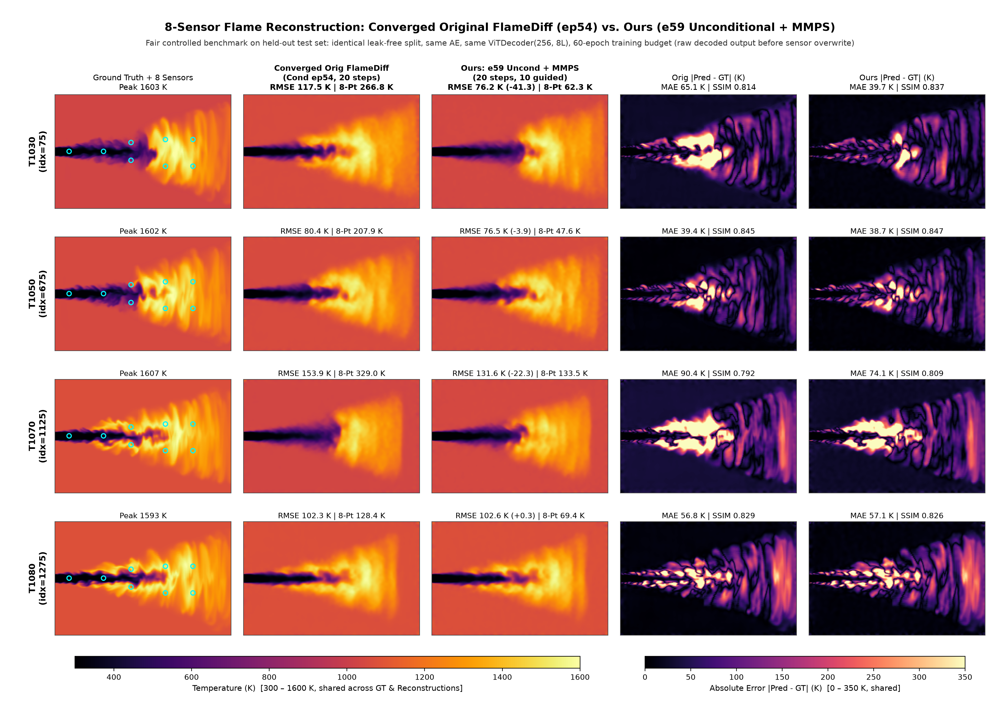
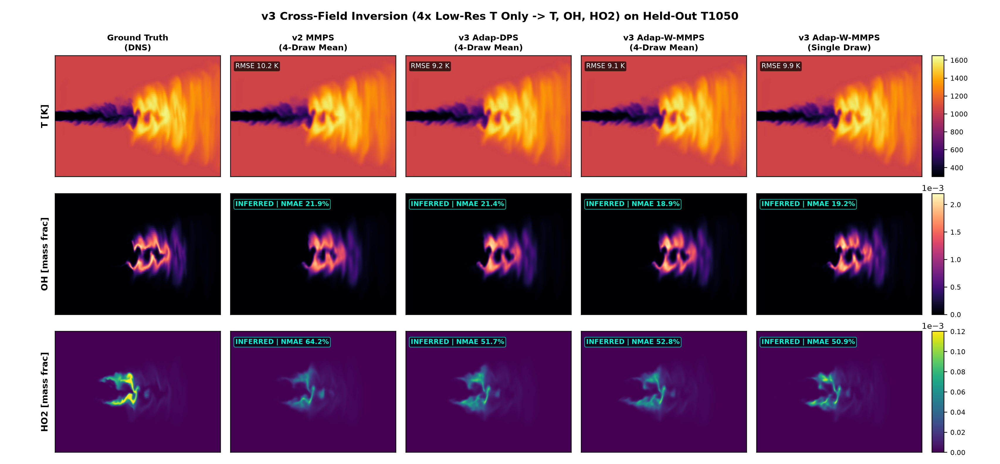
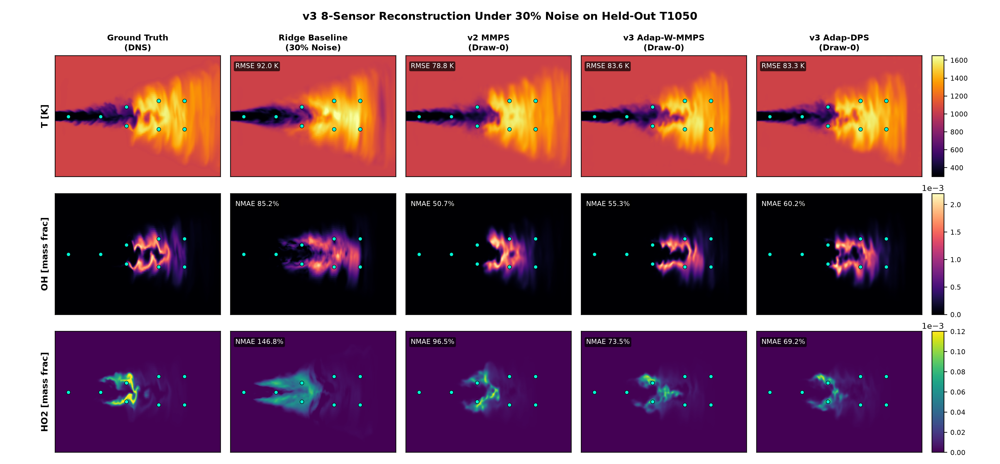
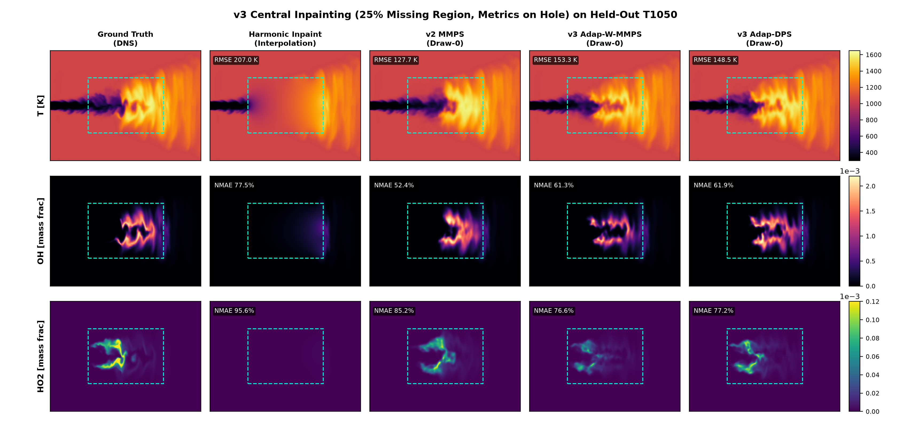

# 湍流火焰场多物理量重建与超分辨率：阶段进度（2026-11-26）

- 代码：`Humorhunter/FlameDiff`，`main` 分支为核心实现与单元测试；消融和诊断脚本放在 `archive/experiments-20261126` 分支。
- 测试集：`test9`，9 个工况各取中值切片的中间帧。时间上严格隔离：训练帧 `[0,130)`，验证帧 `[140,160)`，测试帧 `[170,200)`。
- 下文所有数字均为 `test9` 结果，除非另有说明。

## 1. 研究目标与技术路线

原版 FlameDiff 为条件扩散模型，条件输入固定为 8 个温度测点，仅能完成单通道温度场 `T` 的稀疏重建；观测形式改变时需重新训练。

本阶段采用"无条件先验 + 后验采样"的路线：在潜空间训练一个无条件扩散先验，推理阶段通过 MMPS 后验采样引入观测约束。稀疏测点重建、遮挡修复与超分辨率均表述为同一先验下的线性反问题，仅观测算子不同，因此无需按任务重新训练。

在该框架下完成了以下两项扩展：

1. 重建对象由单通道 `T` 扩展至 `(T, OH, HO2)` 三个物理场，并支持由单一场的观测反演其余未观测场；
2. 借鉴课题组前作（*Combust. Flame* 282, 2025）的自适应归一化方法，改进多通道观测下的后验引导。

## 2. 版本演进

| 版本 | 主要改动 | 新增能力 | 主要结果 |
|---|---|---|---|
| v0 原版 FlameDiff | 上游条件扩散 `ViTDecoder(num_feats=8)` | 只能做单通道 `T`、固定 8 测点 | `T` RMSE 105.0 K（20 步）/ 118.0 K（1000 步） |
| v1 单场 Latent-MMPS | 无条件 ViT 先验 + `spatial_mmps*.py` | 一套权重做 8 测点、中心遮挡、4× 超分 | 8 测点 92.8 K；4× 超分 10.9 K |
| v2 三场统一框架 | 线性编解码器、潜变量标准化、余弦调度 + EMA、通道选择算子 | 同时重建 `(T, OH, HO2)`；只观测 `T` 或 `OH` 反推三场；4 次采样估计不确定性 | 三场 4× 超分均优于 Bicubic；只用低分 `OH` 反推 `T` 误差 46 K |
| v3 自适应引导 | 通道白化 + 自适应步长的 MMPS（`Adap-W-MMPS`）和自适应 DPS（`Adap-DPS`）；补 3 通道监督 U-Net 基线 | `--guidance-mode mmps / dps` 两种引导 | 不重训，`HO2` 误差下降 20–35 个百分点，`T` 下降 13–20 K；30% 噪声下优于监督 U-Net |
| v4 多尺度骨架 + 跨工况（进行中） | `MSCAE` 编码器（3/5/7 多尺度卷积 + PixelShuffle）、`LatentUNet` 先验、潜变量预缓存、`--holdout-cases` | 留出整个 `T1050` 工况测试泛化 | 26 项单元测试通过，正在训练 |

### 各版本训练配置与运行日期

| 版本 | 训练的模型 | 训练设置 | GPU | 运行日期 |
|---|---|---|---|---|
| v0 | 条件 ViT（复用上游 `ae.pt`），作为公平基线重新训练 | 60 epoch，bs 8，lr 2e-5 | Tesla V100S-32GB | 2026-11-24 |
| v1 | 无条件 ViT 先验 `prior.pt`（复用 `ae.pt`） | 60 epoch，bs 4，lr 1e-5 | Tesla V100S-32GB | 2026-11-18 |
| v2 | 三场自编码器 `ae3.pt` + 无条件先验 `prior3.pt` | AE 80 epoch；先验 80 epoch，取第 77 epoch | Tesla V100S-32GB | 2026-11-25 |
| v3 | 不重训，沿用 `prior3.pt`；另训 3 个监督 U-Net 基线 | U-Net 各 40 epoch，bs 16，lr 3e-4 | A100-40GB | 2026-11-26 |
| v4 | `MSCAE` + `LatentUNet` | AE 80 epoch；先验 120k 步 | A100-40GB | 2026-11-26 起（进行中） |

## 3. 结果

### 3.1 单通道 `T`，8 测点：原版 vs v1

推理硬件：V100S。

| 方法 | `T` RMSE [K] | 耗时 [s/帧] |
|---|---:|---:|
| 原版条件 FlameDiff，1000 步 | 118.02 | 4.61 |
| 原版条件 FlameDiff，20 步 | 105.03 | 0.10 |
| v1 Latent-MMPS，20 步 | **92.79** | 1.37 |

和原版最优设置（20 步）相比，v1 误差低 11.7%，但每帧慢约 14 倍。v1 的优势是同一套权重还能做遮挡和超分，原版做不了。

*图 1：8 测点重建。v1 对火焰锋面和高温核心区的还原更接近真值。*

### 3.2 三场 `(T, OH, HO2)` 对比

对比对象：

- **扩散方法**：v2 原始 MMPS、v3 `Adap-W-MMPS`、v3 `Adap-DPS`，三者都使用同一个 57 MB 先验 `prior3.pt`，不针对任务重训；
- **基线**：每个任务单独训练的 3 通道监督 U-Net（每个 17 MB），以及线性 Ridge、调和插值、Bicubic 这些传统方法。

指标说明：

- `T` 用 RMSE [K]，`OH`、`HO2` 用 NMAE [%]，都是越低越好；
- **高频占比**表示单次采样中高波数能量所占比例，用来衡量小尺度湍流结构有没有被抹平。真值为 `OH` 8.78%、`HO2` 17.67%，越接近越好；
- 耗时为 A100 上单次采样时间。误差取 4 次采样的平均值。

**8 测点（无噪声 / 30% 噪声）**

| 方法 | `T` | `OH` | `HO2` | 高频 `OH / HO2` | 耗时 |
|---|---:|---:|---:|---:|---:|
| *无噪声* | | | | | |
| v2 MMPS | 84.61 | 63.0% | 104.6% | 6.42% / 12.09% | 5.2 s |
| v3 Adap-W-MMPS | 71.34 | 54.5% | 72.0% | 7.63% / 12.58% | 9.7 s |
| v3 Adap-DPS | 70.26 | 55.8% | 70.0% | 8.29% / 13.73% | 1.85 s |
| 监督 U-Net | **64.27** | **52.8%** | 71.6% | 0.38% / 2.62% | <0.01 s |
| Ridge | 66.21 | 53.5% | 79.6% | 0.40% / 2.00% | <0.01 s |
| *30% 噪声* | | | | | |
| v3 Adap-W-MMPS | 74.08 | 57.0% | 76.8% | 7.44% / 13.21% | 7.6 s |
| v3 Adap-DPS | **72.03** | **56.9%** | **70.5%** | 8.20% / 13.85% | 1.77 s |
| 监督 U-Net | 92.07 | 71.5% | 104.6% | 0.43% / 1.49% | <0.01 s |
| Ridge | 82.68 | 72.5% | 123.0% | 2.64% / 6.29% | <0.01 s |

**中心遮挡（中间 25% 区域缺失）**

| 方法 | `T` | `OH` | `HO2` | 高频 `OH / HO2` | 耗时 |
|---|---:|---:|---:|---:|---:|
| v2 MMPS | 142.92 | 63.3% | 97.8% | 6.49% / 12.51% | 7.1 s |
| v3 Adap-W-MMPS | 122.61 | 54.8% | 77.2% | 7.81% / 12.97% | 9.6 s |
| v3 Adap-DPS | 119.82 | 55.6% | 71.3% | 7.62% / 12.71% | 1.85 s |
| 监督 U-Net | **104.20** | **47.5%** | **66.6%** | 0.92% / 5.74% | <0.01 s |
| 调和插值 | 220.73 | 84.3% | 86.2% | 3.88% / 7.77% | <0.01 s |

**4× 超分辨率（观测三场低分辨率图）**

| 方法 | `T` | `OH` | `HO2` | 高频 `OH / HO2` | 耗时 |
|---|---:|---:|---:|---:|---:|
| v2/v3 MMPS | 11.63 | 8.5% | 14.2% | 7.32% / 14.20% | 1.3–1.6 s |
| 监督 U-Net | **8.16** | **5.0%** | **8.0%** | 8.63% / 17.21% | <0.01 s |
| Bicubic | 15.10 | 11.5% | 20.1% | 4.46% / 8.42% | <0.01 s |

**跨场反演（只观测一个场的 4× 低分图，重建全部三场）**

监督 U-Net 和插值方法缺少输入通道时无法运行，这里只比较扩散方法。

| 观测 | 方法 | `T` | `OH` | `HO2` | 耗时 |
|---|---|---:|---:|---:|---:|
| 仅 `T` | v2 MMPS | 10.78 | 22.9% | 77.4% | 10.3 s |
| 仅 `T` | v3 Adap-DPS | 10.59 | 18.7% | 43.4% | 1.84 s |
| 仅 `T` | v3 Adap-W-MMPS | **10.23** | **18.0%** | **42.0%** | 12.0 s |
| 仅 `OH` | v2 MMPS | 46.05 | 8.26% | 87.4% | 10.1 s |

### 3.3 结论

1. **v3 相对 v2 提升明显。** 不改权重，只改引导方式，8 测点和遮挡任务上 `T` 降低 13–23 K，`HO2` 降低 20–35 个百分点。
2. **无噪声、固定观测时，监督 U-Net 像素误差最低**，但它把高频结构几乎全部抹平（8 测点 `OH` 高频占比只有 0.38%，真值 8.78%），生成的场明显偏模糊。扩散方法单次采样能保留真值 70%–95% 的高频能量。
3. **加 30% 噪声后，监督 U-Net 和 Ridge 误差大幅上升，扩散方法基本不受影响**，此时 `Adap-DPS` 三个场都优于 U-Net（`T` 低 20 K，`HO2` 低 34 个百分点）。
4. **两种引导方式的取舍**：`Adap-W-MMPS` 在跨场反演和 `OH` 细节上更准；`Adap-DPS` 快约 5 倍，遮挡任务的 `HO2` 略好。
5. **监督 U-Net 的局限**是换观测布局或少一个输入通道就要重训；扩散方法一套权重覆盖上面所有任务，但单帧推理要 1–12 s，比 U-Net 慢两到三个数量级。

## 4. 图

*图 2：A/B 为 8 测点 30% 噪声下各方法误差；C 为仅观测 `T` 时的跨场反演；D 为各方法的高频占比，监督 U-Net 在 8 测点和遮挡任务上接近零。*

*图 3（v3 跨场反演，`T1050`）：仅输入 4× 低分辨率 `T`，对比 v2 MMPS 与 v3 `Adap-DPS`、`Adap-W-MMPS`（4 次采样均值及单次采样）。青色 `INFERRED` 标记表示该通道完全未被观测；v3 对 `HO2` 预热锋面与 `OH` 细节的还原明显优于 v2。*

*图 4（v3 8 测点 30% 噪声，`T1050`）：对比 Ridge、v2 MMPS 与 v3 `Adap-W-MMPS`、`Adap-DPS` 的单次采样结果。Ridge 在强噪声下严重模糊失真，v3 在保留湍流锋面锐度的同时，将 `HO2` 单帧误差由 v2 的 96.5% 降至 73.5% / 69.2%。*

*图 5（v3 中心遮挡，`T1050`）：虚线框为缺失区域（图中数值为缺失区域内单次采样误差，9 工况 4 次采样均值见 3.2 节）。调和插值完全丢失火焰结构，v3 `Adap-W-MMPS` 与 `Adap-DPS` 可在缺失区内重建连续的反应锋面。*

*图 6：`T1050` 工况，同一先验完成 8 测点（无噪 / 30% 噪声）、中心遮挡、4× 超分，以及右侧两列的跨场反演。青色 `INFERRED` 标记表示该通道完全未被观测。*

*图 7：上两行中，4 次采样的标准差（`4-Draw Predictive Std`）与真实误差 `|Mean-GT|` 的分布位置基本一致，都集中在反应锋面；底行中，确定性回归给出的 `OH` 是模糊轮廓，30% 噪声下进一步失真，扩散采样仍保留锐利结构。*

*图 8：三个场的径向功率谱 $E_c(k)$。扩散采样在 $k=10\sim 50$ 与 DNS 真值吻合，Bicubic 和 Ridge 在高频段低 1–3 个数量级。*

## 5. 正在做和下一步

1. **v4 训练（A100 上进行中）**：`MSCAE + LatentUNet`（先验 120k 步），和 v2 的 AE + ViT 做对比；同时把 `T1050` 整个工况从训练中留出，测试对未见工况的泛化。
2. **时空超分（2D+T）**：接入时空样例代码，把当前的三场潜空间和多通道引导扩展到多帧扩散，利用相邻帧的连续性做插帧，并缓解单帧稀疏测点下涡结构位置不确定的问题。
