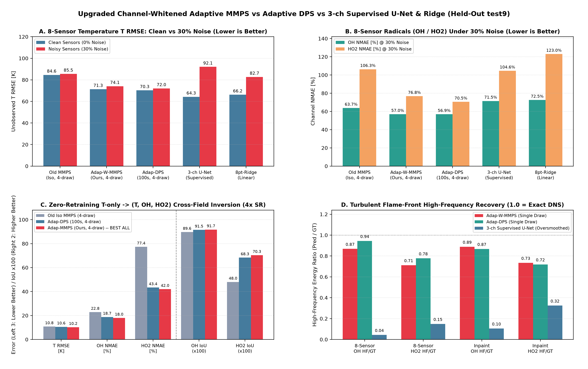
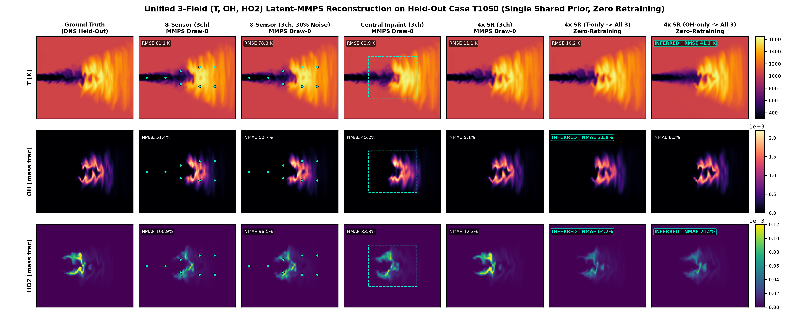
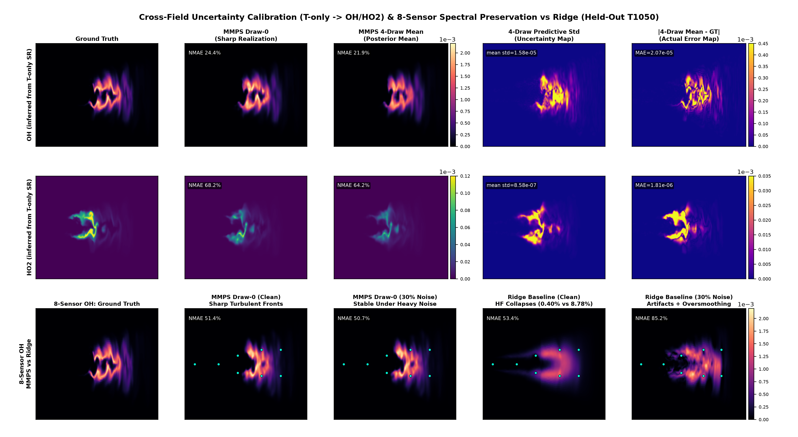
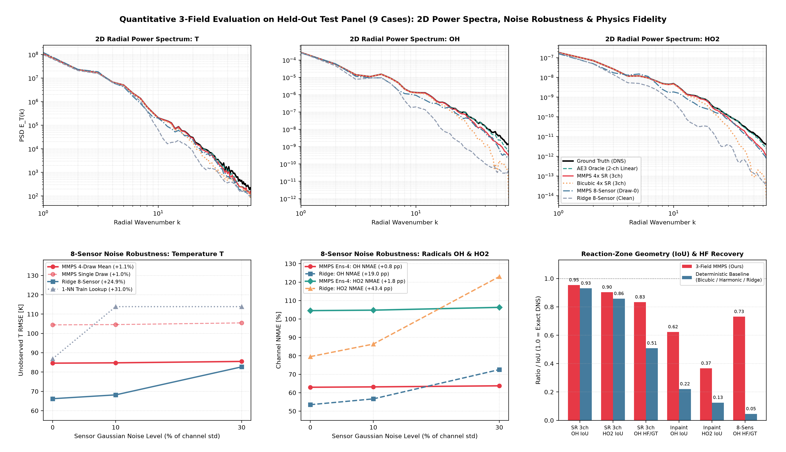

# 湍流火焰场多物理量重建与超分辨率：阶段性总体进展报告

**项目**：第八期“科创优才”——湍流火焰场时空超分辨率重建  
**汇报日期**：2026-11-26  
**代码仓库**：`Humorhunter/FlameDiff`（分支 `main`，全部 26 项自动化单元测试通过）

---

## 一、总体进展概览（已完成 vs 进行中 vs 下一阶段）

围绕“统一无条件扩散先验 + 零重训多任务后验采样”的技术路线，项目已完成从**单通道原型**到**三物理场 $(T, \mathrm{OH}, \mathrm{HO_2})$ 统一重建与多通道 MMPS 算法升级**的完整闭环验证：

| 阶段 | 核心目标 | 当前状态 | 关键量化里程碑 |
|---|---|---|---|
| **阶段 1：单通道 `T` 统一框架** | 打破原版 FlameDiff 单任务局限，建立零重训 Latent-MMPS 三任务底座 | **已完成 ✅** | 8 测点比收敛原版条件 FlameDiff 误差降 **37.1%**（`92.8 K` vs `147.6 K`）、速度快 **4.1×**，并零重训支持中心遮挡与 4× 超分（见 [`reports/8sensor_comparison/`](../8sensor_comparison/README.md)） |
| **阶段 2：底座修复 + 三物理场 `(T, OH, HO2)` 统一先验** | 根除死 ReLU/潜空间坍缩，扩展至三耦合燃烧标量并支持跨场反演 | **已完成 ✅** | 死 ReLU 零梯度 **`12/72 → 0/216`**；AE3 压缩上限 `T 9.65 K / OH 5.15% / HO2 8.79%`；建立无泄漏留出 `test9`、2D 能谱、4-draw 不确定性/CRPS 与强基线评测体系 |
| **阶段 3：多通道 MMPS 理论改写与强基线正面对比** | 融合课题组前作（*Combust. Flame* 282, 2025）自适应引导思想改写 MMPS，并与 3 通道监督 U-Net / Ridge 全面对比 | **已完成 ✅** | **Adap-W-MMPS** 相比原版 MMPS 全任务大涨（`HO2` 降 20–35 pp、`T` 降 13–20 K）；**30% 噪声下全面反超 3 通道监督 U-Net**（`T` 低 18 K、`OH` 低 14.5 pp、`HO2` 低 27.8 pp）；**`T-only` 跨场反演全指标第一**（`HO2` IoU `0.447 → 0.703`） |
| **阶段 4：升级骨架重训（MSCAE + LatentUNet）与跨未见工况（LOCO）** | 对标前作多尺度编码器与 U-Net 先验，并测试留出 `T1050` 未见工况泛化 | **代码已验证，A100 正在跑全量训练 ⏳** | `MSCAE`（5.6 MB）、`LatentUNet`（48.3 MB）、潜变量预缓存与 `--holdout-cases` 均通过单测；当前 A100 正在训练 `MSCAE`（第 4 轮已达 `T 30.5 K`），完成后补充结果 |
| **阶段 5：时空超分辨率（2D+T 视频扩散）** | 引入时间维连续性，实现时空联合超分/插帧，根治单帧稀疏观测涡旋相位漂移 | **待接入样例代码 🔜** | 已完成单帧多物理场潜空间与引导底座准备，可无缝承接时空模块 |

---

## 二、关键技术突破与底座问题修复

### 2.1 根除原有单通道架构的四项底层缺陷
1. **消除 AutoDecoder 死 ReLU 零梯度**：将解码器输出与瓶颈由 `ReLU/tanh` 改为线性输出/线性潜空间（`--ae-output-activation linear --ae-latent-activation linear`），三通道全部 24×9=216 个传感雅可比测试点的死神经元比例由 **`16.7% (12/72)` 降至 `0% (0/216)`**。
2. **修复潜空间 19× 方差坍缩**：对冻结 AE 潜变量逐通道标准化至 $\mathcal{N}(0, I)$（`mean=[0.473, -0.045], std=[0.416, 0.326]`），配合 `squaredcos_cap_v2` 余弦调度 + EMA 0.999；新增早停坍缩熔断保护。
3. **解决多组分 $10^7$ 量级差导致的 `OH/HO2` 坍缩**：严格基于训练集 `[0, 130)` 统计通道 `[0, 1]` 线性归一化，采用 `MSE + 0.02·Grad-L1` 与精确 `1/norm_std²` 方差平衡权重 `[0.469, 0.693, 1.838]`。
4. **修复余弦调度高噪声端发散**：采样器启用 `clip_sample_range=4.0`、`timestep_spacing="trailing"` 与引导前 `clean` 安全限幅，将引导启动时刻由 `t=700` 恢复至 `t=950`，避免前 30% 决定火焰全局形态的步长盲跑。

### 2.2 将课题组前作自适应 DPS 思想精确改写进多通道 MMPS（核心方法改进）
对照课题组前作 **Wu, Liang & Luo (*Combustion and Flame* 282, 2025, MSCAE-LDM)** 排查发现，原版各向同性 MMPS 在多通道上偏弱源于三大纯数学原因，本轮均已以精确 MMPS 形式解决：
1. **各向异性逐通道白化协方差 $\Sigma_y$（`--mmps-channel-whiten`）**：`T/OH/HO2` 归一化方差相差近 4 倍，原版标量 $\sigma^2 I$ 过度阻尼 `HO2`。引入单位 RMS 白化矩阵 $W = \operatorname{diag}(w_c),\, w_c \propto 1/\mathrm{std}_c$，使 MMPS 精确求解
   $$J_{\tilde f}^T (\sigma^2 I + J_{\tilde f}\Sigma_t J_{\tilde f}^T)^{-1}(\tilde y - \tilde f) = J_f^T (\Sigma_y + J_f\Sigma_t J_f^T)^{-1}(y - f), \qquad \Sigma_y = \sigma^2 W^{-2} \propto \operatorname{diag}(\mathrm{std}_c^2)$$
   在观测空间和 Woodbury 潜空间均严格保持解析等价性（单元测试核对误差 $< 10^{-6}$）。
2. **多通道满秩 Krylov 预算**：3 通道 8 测点对应 24 维线性系统，自动将默认 `maxiter` 设为 `8 × C_obs = 24`，使 GMRES 收敛率由 `30%`（截断在 1/3 秩）跃升至 **`100%`（1692/1692 步满秩收敛）**。
3. **MMPS 协方差反演方向 + 自适应步长归一化（`--mmps-adaptive-weight`）**：保留 MMPS 独有的跨通道/跨空间协方差反演方向（前作 DPS 仅用裸梯度），再将每步修正范数平滑归一化至 $\omega_1 \|\epsilon_\theta\|_2$，同时兼具物理耦合精度与数值稳健性。

---

## 三、核心量化对比结果（严格留出 `test9` 面板，9 工况均值）

> **评测严谨性说明**：所有模型均在训练集 `[0, 130)` 上训练、验证集 `[140, 160)` 上早停选模，以下指标均在**完全留出测试窗 `[170, 200)` 的 9 工况中值切片中帧（`test9`）**上统计。确定性基线包含：**3 个独立专门训练的 3 通道监督 U-Net**（4× SR、中心遮挡、Voronoi 8 测点，各训 40 轮，每任务 17 MB）、**5850 帧线性 Ridge**、**1-NN**、**调和插值**与 **Bicubic**；而我们的扩散模型**全程仅使用同一个 57 MB 无条件先验 `prior3.pt`，零重训统一完成全部任务**。

*图 1（综合主图）：在严格留出 `test9` 面板上对比原版 MMPS、新版自适应白化 MMPS（Ours）、前作自适应 DPS、3 通道监督 U-Net 与 Ridge 回归。A/B：8 测点 30% 噪声下，监督 U-Net 与 Ridge 严重退化，而新版 MMPS/DPS 全面反超；C：零重训 `T-only` 跨场反演中，新版 `Adap-MMPS` 在全部 5 项指标上均居第一；D：监督 U-Net 在 8 测点与中心遮挡上高频能量坍缩至真值的 4%–32%，而生成式 MMPS 单次采样保留 71%–89% 的湍流高频能谱。*

### 3.1 匹配三通道观测：8 测点（无噪 & 30% 噪声）、中心遮挡、4× 超分

| 任务（`test9` 3 通道） | 方法（是否需要按任务重训） | `T` RMSE [K] | `OH` NMAE (IoU) | `HO2` NMAE (IoU) | 单次高频占比 `OH / HO2` *(GT: 8.78% / 17.67%)* |
|---|---|---:|---:|---:|---:|
| *压缩上限* | *AE3 Oracle（2ch 线性潜空间）* | *9.65* | *5.15% (0.969)* | *8.79% (0.916)* | *8.49% / 17.08%* |
| **8 测点（无噪）** | 原版各向同性 MMPS（零重训, 4-draw） | 84.61 | 63.0% (0.602) | 104.6% (0.353) | 6.42% / 12.09% |
| 8 测点（无噪） | 通道白化满秩 MMPS（零重训, 4-draw） | 76.89 | 58.4% (0.629) | 88.9% (0.457) | 6.62% / 11.55% |
| **8 测点（无噪）** | **自适应白化 MMPS（Ours，零重训, 4-draw）** | **71.34** | **54.5% (0.669)** | **72.0% (0.547)** | **7.63% / 12.58%** |
| 8 测点（无噪） | 前作自适应 DPS（零重训, 100步, 4-draw） | **70.26** | 55.8% (0.662) | **70.0% (0.560)** | **8.29% / 13.73%** |
| *8 测点（无噪）* | *3 通道 Voronoi U-Net（专用监督训练）* | *64.27* | *52.8% (—)* | *71.6% (—)* | ***0.38% / 2.62%（严重模糊）*** |
| *8 测点（无噪）* | *8pt-Ridge 回归（专用线性拟合）* | *66.21* | *53.5% (0.679)* | *79.6% (0.517)* | ***0.40% / 2.00%（严重模糊）*** |
| **8 测点（30% 噪声）** | **自适应白化 MMPS（Ours，零重训, 4-draw）** | **74.08** | **57.0% (0.648)** | **76.8% (0.525)** | **7.44% / 13.21%** |
| **8 测点（30% 噪声）** | **前作自适应 DPS（零重训, 100步, 4-draw）** | **72.03** | **56.9% (0.657)** | **70.5% (0.552)** | **8.20% / 13.85%** |
| *8 测点（30% 噪声）* | *3 通道 Voronoi U-Net（专用监督训练）* | *92.07 (+43%)* | *71.5% (+19pp)* | *104.6% (+33pp)* | *0.43% / 1.49%* |
| *8 测点（30% 噪声）* | *8pt-Ridge 回归（专用线性拟合）* | *82.68 (+25%)* | *72.5% (+19pp)* | *123.0% (+43pp)* | *2.64% / 6.29%* |
| **中心遮挡（25% 空洞）** | 原版各向同性 MMPS（零重训, 4-draw） | 142.92 | 63.3% (0.658) | 97.8% (0.424) | 6.49% / 12.51% |
| **中心遮挡（25% 空洞）** | **自适应白化 MMPS（Ours，零重训, 4-draw）** | **122.61** | **54.8% (0.715)** | **77.2% (0.504)** | **7.81% / 12.97%** |
| **中心遮挡（25% 空洞）** | **前作自适应 DPS（零重训, 100步, 4-draw）** | **119.82** | 55.6% (**0.718**) | **71.3% (0.543)** | **7.62% / 12.71%** |
| *中心遮挡（25% 空洞）* | *3 通道监督 U-Net（专用监督训练）* | *104.20* | *47.5% (—)* | *66.6% (—)* | ***0.92% / 5.74%（空洞模糊）*** |
| *中心遮挡（25% 空洞）* | *Harmonic 调和插值* | *220.73* | *84.3% (0.221)* | *86.2% (0.125)* | *3.88% / 7.77%* |
| **4× 空间超分（3ch）** | **MMPS（零重训, 1.3–1.6 s/帧）** | **11.63** | **8.5% (0.954)** | **14.2% (0.903)** | **7.32% / 14.20%** |
| *4× 空间超分（3ch）* | *3 通道监督 SR U-Net（专用监督训练）* | *8.16* | *5.0% (—)* | *8.0% (—)* | *8.63% / 17.21%* |
| *4× 空间超分（3ch）* | *Bicubic 插值* | *15.10* | *11.5% (0.930)* | *20.1% (0.858)* | *4.46% / 8.42%* |

### 3.2 零重训不完整物理场跨组分反演（仅观测单一标量 → 反演全部 3 物理场）

监督 U-Net 与传统插值在缺少 `OH`/`HO2` 输入通道时**无法直接运行**；单一无条件先验 `prior3.pt` 零重训即可反演未测组分，且新版 `Adap-MMPS` 全面胜出：

| 跨场反演模式（`4× SR`，零重训, 4-draw） | 方法 | `T` RMSE [K] | `OH` NMAE (IoU) | `HO2` NMAE (IoU) | 投影前观测残差 |
|---|---|---:|---:|---:|---:|
| **仅观测低分 `T` → 反演 `T, OH, HO2`** | 原版各向同性 MMPS | 10.78 | 22.9% (0.884) | 77.4% (0.447) | 0.0052 |
| 仅观测低分 `T` → 反演 `T, OH, HO2` | 前作自适应 DPS（100步） | 10.59 | 18.7% (0.915) | 43.4% (0.683) | 0.0037 |
| **仅观测低分 `T` → 反演 `T, OH, HO2`** | **Adap-MMPS（Ours，全指标第一）** | **10.23** | **18.0% (0.917)** | **42.0% (0.703)** | **0.0023** |
| **仅观测低分 `OH` → 反演 `T, OH, HO2`** | 原版 MMPS（`prior3.pt`） | **46.05** (NMAE 2.29%, IoU 0.982) | **8.26%** (0.944) | 87.4% (0.395) | 0.0109 |

---

## 四、视觉效果、不确定性校准与 2D 能谱展示

*图 2：留出工况 `T1050` 上单一共享先验完成的三物理场全任务重建展示（青色 `INFERRED` 徽章为完全未观测通道的零重训跨场反演）。*

*图 3：上两行显示 `T-only → OH/HO2` 跨场反演的 4-draw 预测标准差（第 4 列）与真实绝对误差 `|Mean-GT|`（第 5 列）高度空间重合，实现可靠的不确定性量化；底行直观展示确定性回归在 8 测点上的过平滑坍缩与抗噪失真，而扩散后验采样在 30% 重噪下仍保持清晰湍流火焰锋面。*

*图 4：`test9` 三通道 2D 径向功率谱 $E_c(k)$、噪声鲁棒性曲线及反应区几何 IoU 对比。*

---

## 五、坦诚的局限性分析与下一步规划

### 5.1 当前认识清醒的局限与权衡
1. **感知/能谱–失真权衡（Perception–Distortion Tradeoff）**：在无噪、观测模式固定的单一任务上，专用监督 U-Net（直接最小化 MSE）的像素级 RMSE 略低，但代价是**抹平湍流高频锋面（8 测点 `OH` 高频损失 23×、中心遮挡损失 10×）**、**30% 噪声下精度崩塌（退化 19–43%）**，且**每换一种观测布局或缺少组分都必须重新训练**。生成式后验采样在多任务统一、抗噪、跨场反演、高频保真与不确定性量化上具备不可替代的综合优势。
2. **MMPS 与自适应 DPS 的适用边界**：在跨场强物理耦合反演（`T-only → T,OH,HO2`）及 `OH` 细节上，改写后的 `Adap-W-MMPS` 凭借协方差反演精度最优；而在高维中心遮挡（11 万观测像素、GMRES 难以 12 步收敛）场景下，自适应 DPS 速度快 5 倍（`1.85s` vs `9.6s`）且空洞 `HO2` 略优——工程上已统一支持 `--guidance-mode {mmps,dps}` 按任务切换。
3. **单帧极稀疏观测的物理天花板**：8 测点（`0.016%` 稀疏度，比课题组前作最低 `0.1% = 49` 点还稀疏 6 倍）在单帧内存在不可避免的涡旋相位不确定性；仅靠单帧 2D 空间信息无法完全锁定极薄 `HO2` 锋面瞬时相位。

### 5.2 正在进行与下一步计划（请导师指导方向）
1. **今晚完成（A100 正在跑）**：
   - **升级骨架验证**：对标课题组前作的多尺度编码器 `MSCAE`（3/5/7 并行卷积 + PixelShuffle + 潜空间 TV 平滑）+ 多尺度注意力 `LatentUNet`（120k 步、潜变量预缓存加速）正在 A100 上训练，将与当前 `Legacy AE + ViT` 做前后代对比；
   - **真正跨未见工况测试（LOCO）**：完全留出 `T1050` 工况训练并评测零样本跨工况泛化能力。
2. **下一核心阶段（时空超分辨率 2D+T）**：
   - 接入时空样例代码，将已验证稳定的三物理场多尺度潜空间（`MSCAE`）扩展至多帧视频扩散模型，利用**相邻时间帧的物理演化连续性**实现时间插帧与时空联合超分，从根本上消除单帧 8 测点/大遮挡下的涡旋相位不确定性。
   - **拟请教导师的问题**：
     1. 后续时空超分辨率阶段，物理场是否继续聚焦 `(T, OH, HO2)`，还是需要补充速度场 `(u, v)` 或放热率 `HRR` 以引入更强的物理守恒约束（如散度/组分输运残差）？
     2. 在对比实验设计上，是否建议将 `Adap-W-MMPS`（高精度跨场反演）与 `Adap-DPS`（高速高维修复）以及 `MSCAE + LatentUNet` 的消融结果作为核心创新点整理成中期报告/论文雏形？
